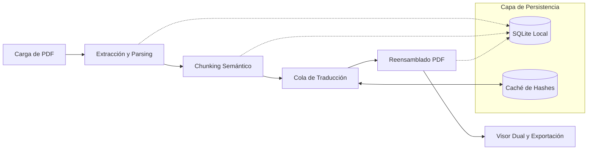

# Especificación Técnica y de Producto: DocuLingua (PDFTranslate)
**Versión del Documento:** 1.0.0  
**Autor:** Lead Mobile Architect & Senior Fullstack Engineer  
**Estado:** Aprobado para Implementación (Fase 1)  
**Fecha:** Octubre 2026  

---

## 1. Visión General y Límites del MVP

### 1.1. Propuesta de Valor y Problema
En el ámbito académico, científico y profesional contemporáneo, el 85% de la literatura técnica de frontera (papers de arXiv, estándares IEEE, publicaciones ACM, documentación de software y manuales de ingeniería) se publica exclusivamente en inglés. Los profesionales e investigadores hispanohablantes enfrentan una fricción cognitiva significativa al consultar estos documentos en pantallas móviles o tablets.

Las herramientas de traducción existentes presentan deficiencias críticas:
1. **Pérdida de contexto estructural:** Las herramientas web y de portapapeles destruyen la paginación, notas al pie y continuidad de párrafos.
2. **Falta de lectura comparativa:** No ofrecen un visor sincronizado (*side-by-side*) que permita contrastar el término técnico original con la traducción.
3. **Poco control de costos y offline:** No almacenan en caché traducciones repetidas ni permiten reanudar trabajos ante caídas de conexión.

**DocuLingua** resuelve este problema ofreciendo un pipeline móvil optimizado de extracción, traducción semántica y reensamblado de PDFs de inglés a español, complementado con un lector dual interactivo de alto rendimiento.

---

### 1.2. Flujo Principal del Sistema (End-to-End)



1. **Ingesta:** El usuario selecciona un archivo local o comparte un PDF desde cualquier app (Drive, Chrome, Telegram) mediante intents nativos del sistema.
2. **Análisis y Extracción:** Se procesa el árbol interno del PDF, extrayendo texto estructurado mapeado a números de página y delimitadores de párrafo.
3. **Tokenización y Chunking:** Se divide el contenido en bloques semánticos coherentes (oraciones/párrafos completos) respetando estrictamente los límites de página y umbrales de tokens.
4. **Traducción Asíncrona:** Una cola de ejecución gestiona las peticiones contra la API seleccionada (DeepL / OpenAI / Google Translate), consultando primero la caché local de hashes SHA-256 para evitar costos redundantes.
5. **Reconstrucción:** Se genera un documento estructurado en español manteniendo la correlación 1:1 con las páginas del documento original.
6. **Consumo y Distribución:** El usuario accede al visor dual sincronizado con resaltado de párrafos o exporta el PDF traducido en múltiples formatos.

---

### 1.3. Alcance del MVP: Fase 1 (Nativo) vs. Fase 2 (OCR)

| Capacidad | Fase 1: MVP (Texto Nativo) | Fase 2: Post-MVP (OCR & Scans) |
| :--- | :--- | :--- |
| **Tipo de Documentos** | PDFs digitales con texto vectorial seleccionable. | PDFs escaneados, imágenes fotocopiadas, faxes. |
| **Pipeline de Extracción** | Stream parsing de fuentes incrustadas (TrueType/Type1/ToUnicode CMap). | Google ML Kit Text Recognition on-device + Cloud Vision fallback. |
| **Rendimiento de Extracción** | < 1.5 segundos para 50 páginas. | 1.5 - 3.5 segundos por página (intensivo en GPU/NPU). |
| **Tratamiento de Fórmulas y Código** | Detección heurística de bloques `<notranslate>` para preservar notación matemática. | Detección de layout multizona con modelos de segmentación de documentos. |
| **Consumo de Memoria** | Muy bajo (< 80 MB de heap RAM). | Moderado / Alto (requiere procesamiento de bitmaps con reciclado agresivo). |

---

## 2. Arquitectura de Software y Pipeline de Traducción

### 2.1. Selección Justificada del Stack Tecnológico

Tras evaluar **React Native (Expo SDK 52+ / TypeScript)**, **Flutter (Dart)** y **Android Nativo (Kotlin/Compose)**:

* **Opción Seleccionada:** **React Native con Expo (TypeScript)** utilizando arquitectura modular y prebuild nativo.
* **Justificación Arquitectónica:**
  1. **Velocidad de Iteración en UI Reactiva:** La implementación del visor interactivo dual con sincronización de scroll entre columnas requiere primitivas de alto nivel como `react-native-reanimated` y `react-native-gesture-handler`, ofreciendo 60/120 FPS sin bloqueos en el hilo principal.
  2. **Manipulación de Archivos y Sandbox:** `expo-file-system` y `expo-document-picker` proporcionan una abstracción robusta y multiplataforma del Scoped Storage de Android y el App Sandbox de iOS.
  3. **Generación Dinámica de PDFs:** Integración con `expo-print` y `pdf-lib` para compilar PDFs bilingües y maquetados mediante plantillas HTML/CSS Paged Media (`@page { size: A4; margin: 20mm; }`), asegurando tipografía idéntica y saltos de página perfectos.
  4. **Persistencia Local:** `expo-sqlite` (Next) ofrece transacciones ACID SQLite en C++ sin el sobrecosto de puentes tradicionales, ideal para miles de fragmentos y caché de traducción.

---

### 2.2. Arquitectura Modular del Proyecto

La estructura sigue principios de **Clean Architecture** y **Feature-Driven Packaging**:

```text
/
├── PROJECT_SPEC.md                     # Este documento de especificación
├── app.json                            # Configuración de Expo y Plugins Nativos
├── package.json                        # Dependencias de producción y desarrollo
├── tsconfig.json                       # Configuración estricta de TypeScript
├── assets/                             # Iconos, splash screens y fuentes locales
└── src/
    ├── modules/
    │   ├── pdf/                        # Módulo de manipulación y análisis de PDF
    │   │   ├── extractors/             # Motores de extracción de texto y metadatos
    │   │   │   ├── NativePdfExtractor.ts
    │   │   │   └── Types.ts
    │   │   ├── generators/             # Compilación y maquetación de PDFs resultantes
    │   │   │   ├── HtmlTemplateBuilder.ts
    │   │   │   └── PdfExportService.ts
    │   │   ├── parser/                 # Segmentación de párrafos y sanitización
    │   │   │   ├── ParagraphTokenizer.ts
    │   │   │   └── HyphenNormalizer.ts
    │   │   └── renderers/              # Componentes de renderizado de páginas
    │   │       ├── PageRenderer.tsx
    │   │       └── DualPageSyncView.tsx
    │   │
    │   ├── translator/                 # Core de traducción y orquestación de APIs
    │   │   ├── adapters/               # Patrón Adaptador para proveedores de traducción
    │   │   │   ├── ITranslatorAdapter.ts
    │   │   │   ├── DeepLTranslatorAdapter.ts
    │   │   │   ├── OpenAITranslatorAdapter.ts
    │   │   │   └── GoogleTranslateAdapter.ts
    │   │   ├── cache/                  # Gestión de caché local de traducciones
    │   │   │   └── TranslationCacheManager.ts
    │   │   ├── chunker/                # Algoritmos de particionado semántico
    │   │   │   └── SemanticChunker.ts
    │   │   └── queue/                  # Cola con control de concurrencia y reintentos
    │   │       ├── PriorityQueue.ts
    │   │       └── TranslationJobRunner.ts
    │   │
    │   └── dualViewer/                 # Lector interactivo bilingüe
    │       ├── components/
    │       │   ├── SplitColumnView.tsx
    │       │   ├── SyncedScrollView.tsx
    │       │   ├── ParagraphHighlight.tsx
    │       │   └── ReaderToolbar.tsx
    │       └── hooks/
    │           ├── useDualSyncScroll.ts
    │           └── useTextSearch.ts
    │
    ├── screens/                        # Pantallas principales de navegación
    │   ├── Library/                    # Pantalla 1: Historial y Biblioteca
    │   │   ├── LibraryScreen.tsx
    │   │   └── components/DocumentCard.tsx
    │   ├── PreviewConfig/              # Pantalla 2: Vista previa y selección de páginas
    │   │   ├── PreviewConfigScreen.tsx
    │   │   └── components/PageRangeSelector.tsx
    │   ├── Progress/                   # Pantalla 3: Progreso en tiempo real
    │   │   ├── ProgressScreen.tsx
    │   │   └── components/ProgressStages.tsx
    │   ├── DualViewer/                 # Pantalla 4: Visor interactivo EN/ES
    │   │   └── DualViewerScreen.tsx
    │   └── Export/                     # Pantalla 5: Opciones de exportación y guardado
    │       ├── ExportScreen.tsx
    │       └── components/ExportActionButtons.tsx
    │
    ├── storage/                        # Capa de datos y persistencia
    │   ├── db/                         # Inicialización y migraciones SQLite
    │   │   ├── DatabaseConnection.ts
    │   │   └── Migrations.ts
    │   ├── repositories/               # Patrón Repositorio para entidades
    │   │   ├── DocumentRepository.ts
    │   │   ├── ChunkRepository.ts
    │   │   └── SettingsRepository.ts
    │   └── models/                     # Entidades tipadas de persistencia
    │       └── Entities.ts
    │
    ├── services/                       # Servicios de infraestructura
    │   ├── fileManager/                # Copia segura, hashing y borrado temporal
    │   │   └── LocalFileManager.ts
    │   ├── shareIntent/                # Recepción de archivos compartidos desde el SO
    │   │   └── ShareIntentListener.ts
    │   └── network/                    # Monitoreo de conectividad (NetInfo)
    │       └── NetworkSupervisor.ts
    │
    ├── theme/                          # Sistema de diseño, tokens, colores y tipografía
    │   ├── colors.ts
    │   ├── typography.ts
    │   └── spacing.ts
    │
    ├── types/                          # Definición global de tipos e interfaces
    │   └── index.ts
    │
    └── utils/                          # Funciones auxiliares puras
        ├── sha256.ts
        ├── formatters.ts
        └── logger.ts
```

---

### 2.3. Pipeline Detallado de Procesamiento

#### 1. Ingesta y Recepción de Archivos
* **Acceso por Document Picker:** Uso de `expo-document-picker` filtrado por `application/pdf`.
* **Acceso por Sistema "Compartir con...":** Registro en `AndroidManifest.xml` del `IntentFilter`:
  ```xml
  <intent-filter>
      <action android:name="android.intent.action.SEND" />
      <category android:name="android.intent.category.DEFAULT" />
      <data android:mimeType="application/pdf" />
  </intent-filter>
  ```
* **Copia Segura:** El archivo temporal externo se copia de inmediato al directorio interno protegido de la app (`${FileSystem.documentDirectory}/documents/${documentId}/original.pdf`).

#### 2. Extracción de Texto Estructurado
* Se extrae el contenido página a página. Cada página emite un flujo de texto que pasa por el `ParagraphTokenizer`:
  * **Normalización de guiones de final de línea:** Convierte palabras cortadas como `"trans-\nformation"` en `"transformation"`.
  * **Detección de párrafos:** Reconoce saltos de línea dobles (`\n\n`) y sangrías para delimitar unidades semánticas completas.
  * **Asignación de IDs de anclaje (`anchorId`):** Cada párrafo recibe un identificador único en formato `p_{pageNumber}_{paragraphIndex}` (ejemplo: `p_3_12`) para enlazar el original con la traducción en el visor sincronizado.

#### 3. Lógica de Chunking Semántico
* **Regla 1 (Frontera dura de página):** Un fragmento de traducción **nunca** cruza de una página a otra. La correspondencia original-traducción se mantiene confinada a su respectiva página.
* **Regla 2 (Umbral de tamaño):** El tamaño objetivo de cada fragmento oscila entre **1,500 y 2,500 caracteres** (aproximadamente 350 - 550 palabras). Si un párrafo supera este límite, se subdivide a nivel de oraciones respetando signos de puntuación (`.`, `?`, `!`).
* **Regla 3 (Aislamiento de no-traducción):** Fragmentos con sintaxis de código (`func(...)`, `import ...`) o variables matemáticas se envuelven en etiquetas `<span class="notranslate">` o marcadores de escape de acuerdo a la API del proveedor.

#### 4. Orquestación de la Traducción y Control de Costos
* **Hash Caching:** Antes de despachar un fragmento a la red, se calcula su hash SHA-256 (`hash = sha256(originalText + targetLang)`). Se consulta la tabla `translation_cache`. Si existe coincidencia previa, se devuelve la traducción almacenada con 0ms de latencia y costo $0.
* **Manejo de Errores y Concurrencia:**
  * Máximo **3 peticiones concurrentes** para evitar errores HTTP 429 (*Rate Limit*).
  * Reintentos automáticos mediante **Exponential Backoff con Jitter**:
    $$T_{\text{wait}} = \min(T_{\text{max}}, T_{\text{base}} \times 2^{\text{attempt}}) \pm \text{random\_jitter}$$
  * Si el servidor responde `HTTP 401/403` (credenciales inválidas), el trabajo se detiene inmediatamente alertando al usuario.

#### 5. Reensamblado y Generación de PDF en Español
* Se compila un documento HTML estandarizado que incluye estilos de impresión CSS Paged Media.
* Se inyecta una tipografía limpia y legible (Inter o Roboto) con jerarquía clara de títulos (`h1`, `h2`), párrafos y numeración de pie de página: `"Página X de Y - DocuLingua"`.
* Se ejecuta `expo-print` para generar el archivo binario `translated.pdf` de forma local en el dispositivo.

---

## 3. Flujo de Usuario y Especificación de Pantallas

### 3.1. Pantalla 1: Biblioteca / Historial (`LibraryScreen`)
* **Propósito:** Centro de control del usuario para consultar documentos traducidos, continuar lecturas y cargar nuevos archivos.
* **Elementos UI:**
  * **Header:** Título "Mis Documentos", barra de búsqueda en tiempo real por nombre de archivo, y switch de filtro (Todos | Completados | En Progreso).
  * **Panel de Métricas:** Fila compacta con estadísticas: "Páginas traducidas", "Palabras ahorradas" y "Créditos/Tokens utilizados".
  * **Lista de Documentos:** `FlatList` virtualizado con tarjetas `DocumentCard`:
    * Thumbnail de la primera página del documento.
    * Título del documento y tamaño en MB.
    * Chips de estado: `[Completado]` (verde), `[Pausado]` (amarillo), `[Error]` (rojo), `[Extrayendo]` (azul).
    * Barra de lectura indicando la última página visualizada (ejemplo: "Pág 8 de 45").
    * Menú contextual de tres puntos: "Ver Visor Dual", "Exportar PDF", "Eliminar".
  * **Floating Action Button (FAB):** Botón flotante prominente con ícono `+` y etiqueta "Traducir Documento".

### 3.2. Pantalla 2: Vista Previa y Configuración (`PreviewConfigScreen`)
* **Propósito:** Permitir al usuario inspeccionar el documento antes de gastar recursos de traducción y parametrizar la tarea.
* **Elementos UI:**
  * **Visor de Páginas Miniatura:** Carrusel horizontal de miniaturas con casillas de verificación para seleccionar/deseleccionar páginas específicas.
  * **Selector de Modo de Rango:**
    * Opción A: "Todo el documento" (ej. 1 - 34).
    * Opción B: "Rango personalizado" con campos de entrada numéricos `[Desde] - [Hasta]`.
    * Opción C: "Selección manual de páginas".
  * **Panel de Estimación Dinámica:**
    * Conteo total de páginas a procesar.
    * Estimación de caracteres y palabras.
    * Coste aproximado en tokens de API o consumo de cuota DeepL.
    * Tiempo estimado de finalización (ejemplo: "~1 min 20 seg").
  * **Selector de Proveedor de Traducción:** Selector con logos y nombres (DeepL Pro / Free, OpenAI GPT-4o-mini, Google Cloud Translation).
  * **Tono / Dominio:** Selector de estilo de traducción (Académico / Científico, Técnico / Informática, General).
  * **Botón de Acción Principal (CTA):** "Iniciar Traducción" con estado de validación habilitado.

### 3.3. Pantalla 3: Progreso en Tiempo Real (`ProgressScreen`)
* **Propósito:** Informar de forma transparente el estado exacto del pipeline durante operaciones que pueden demorar varios minutos.
* **Elementos UI:**
  * **Indicador de Progreso Circular o Barra Lineal con Porcentaje:** Valor numérico del 0 al 100%.
  * **Stepper de Etapas de Procesamiento:**
    1. *Extracción de Texto:* "Extrayendo páginas 1 a 20..." (Checkmark al completar).
    2. *Segmentación Semántica:* "Estructurando 84 párrafos..." (Checkmark al completar).
    3. *Traducción en Curso:* "Traduciendo página 8 de 20 (Fragmento 32/84)" con barra de avance individual.
    4. *Compilación del Documento:* "Generando PDF en español...".
  * **Registro en Vivo (Live Console Plegable):** Muestra mensajes informativos breves (`[10:42:15] Fragmento 12 traducido exitosamente`).
  * **Controles del Job:**
    * Botón "Pausar" / "Reanudar".
    * Botón "Continuar en segundo plano" (activa notificación persistente del sistema).
    * Botón "Cancelar" con modal de confirmación advirtiendo que los fragmentos ya traducidos se conservarán en caché.

### 3.4. Pantalla 4: Visor Dual Interactivo (`DualViewerScreen`)
* **Propósito:** Experiencia central de lectura y estudio comparativo del documento original y traducido.
* **Modos de Visualización:**
  * **Modo A: Pantalla Dividida (Side-by-Side):**
    * Activo por defecto en tablets y en orientación horizontal en smartphones.
    * Dos columnas de ancho idéntico: Columna Izquierda (Original en inglés), Columna Derecha (Traducido al español).
  * **Modo B: Alternancia Rápida (Toggle Switch):**
    * Segmented control en el AppBar: `[Inglés (Original)]` | `[Español (Traducido)]`.
    * Transición fluida entre ambos documentos conservando la posición exacta del cursor de lectura.
  * **Modo C: División Vertical Sincronizada (Split Vertical en Móviles):**
    * Mitad superior: Página original en inglés con zoom táctil.
    * Mitad inferior: Párrafos traducidos en español con auto-desplazamiento.
* **Interacciones Avanzadas:**
  * **Sincronización de Scroll:** Al desplazar el texto en cualquiera de las columnas, la columna adyacente se alinea automáticamente con el párrafo homólogo (`p_X_Y`).
  * **Resaltado Táctil:** Al pulsar un párrafo en inglés, se ilumina con un suave fondo azul tanto en la vista inglesa como en su contraparte en español.
  * **Ajustes de Lectura:** Menú desplegable para regular tamaño de fuente (12pt a 24pt), interlineado, y temas de fondo (Blanco Puro, Sepia para fatiga visual, Modo Oscuro OLED).

### 3.5. Pantalla 5: Opciones de Exportación (`ExportScreen`)
* **Propósito:** Facilitar la descarga, distribución e impresión del resultado procesado.
* **Opciones de Salida:**
  1. **Descargar PDF en Español:** Almacena el PDF resultante en la carpeta de descargas del usuario mediante el SAF (*Storage Access Framework*).
  2. **Descargar PDF Bilingüe (Estudio):** Genera un PDF maquetado con páginas pares en inglés y páginas impares en español, idóneo para impresión en formato libro o estudio académico.
  3. **Compartir Archivo:** Invoca la hoja de compartir nativa del sistema operativo (`expo-sharing`) para remitir el PDF a apps de mensajería, correo electrónico o almacenamiento en la nube.
  4. **Copiar Texto Completo:** Extrae todo el texto traducido al portapapeles del dispositivo o lo exporta como archivo `.txt` / `.md`.
  5. **Imprimir:** Envío directo al subsistema de impresión del dispositivo (`PrintManager`).

---

## 4. Modelos de Datos, Tipado y Esquema de Base de Datos

### 4.1. Interfaces TypeScript (`src/types/index.ts`)

```typescript
export type TranslationStatus = 
  | 'pending'
  | 'extracting'
  | 'chunking'
  | 'translating'
  | 'assembling'
  | 'completed'
  | 'paused'
  | 'failed';

export type TranslationProviderId = 'deepl' | 'openai' | 'google';

export type TranslationTone = 'academic' | 'technical' | 'general';

export interface DocumentMetadata {
  author?: string;
  creator?: string;
  keywords?: string[];
  originalLanguage: string;
  targetLanguage: string;
}

export interface DocumentItem {
  id: string;                         // UUID v4
  title: string;                      // Nombre del archivo o título del PDF
  originalFilePath: string;           // Ruta local al archivo original
  translatedFilePath?: string;        // Ruta local al PDF generado en español
  originalPageCount: number;          // Total de páginas del PDF original
  selectedPageRange: number[];        // Lista de páginas seleccionadas para traducción
  fileSizeBytes: number;              // Peso en bytes
  status: TranslationStatus;          // Estado actual del documento
  createdAt: number;                  // Timestamp Unix (ms)
  updatedAt: number;                  // Timestamp Unix (ms)
  lastReadPageIndex: number;          // Última página leída para reanudar lectura
  metadata: DocumentMetadata;
}

export interface PageChunk {
  id: string;                         // UUID v4
  documentId: string;                 // Llave foránea hacia DocumentItem
  pageNumber: number;                 // Número de página física (1-indexed)
  paragraphIndex: number;             // Índice del párrafo dentro de la página
  anchorId: string;                   // Identificador de sincronización (ej: "p_4_2")
  originalText: string;               // Texto en inglés sin traducir
  translatedText?: string;            // Texto traducido al español
  hashSha256: string;                 // Hash para deduplicación y caché
  tokenCount: number;                 // Cantidad de tokens estimados
  charCount: number;                  // Longitud de caracteres
  status: 'pending' | 'in_flight' | 'completed' | 'failed';
  errorMessage?: string;
  orderIndex: number;                 // Orden secuencial de lectura
}

export interface TranslationJob {
  id: string;                         // UUID v4 del trabajo
  documentId: string;                 // Documento asociado
  provider: TranslationProviderId;    // Proveedor configurado
  tone: TranslationTone;              // Tono seleccionado
  totalChunks: number;                // Total de chunks a procesar
  completedChunks: number;            // Chunks terminados con éxito
  failedChunks: number;               // Chunks con error
  inFlightChunks: number;             // Chunks enviándose en este instante
  startedAt: number;                  // Timestamp de inicio
  completedAt?: number;               // Timestamp de finalización
  errorLog?: string[];                // Historial de incidencias
}

export interface AppSettings {
  defaultProvider: TranslationProviderId;
  deeplApiKey?: string;
  openaiApiKey?: string;
  googleApiKey?: string;
  openAiModel: 'gpt-4o-mini' | 'gpt-4o' | 'gpt-3.5-turbo';
  cacheEnabled: boolean;
  maxConcurrentRequests: number;      // Por defecto: 3
  readerFontSize: number;             // Por defecto: 16
  readerTheme: 'light' | 'sepia' | 'dark';
  keepOriginalLayout: boolean;
}

export interface TranslationCacheEntry {
  hashSha256: string;                 // Clave primaria
  originalText: string;
  translatedText: string;
  sourceLang: string;
  targetLang: string;
  provider: TranslationProviderId;
  createdAt: number;
}
```

---

### 4.2. Esquema Relacional SQLite (`src/storage/db/Migrations.ts`)

```sql
-- Tabla principal de documentos
CREATE TABLE IF NOT EXISTS documents (
    id TEXT PRIMARY KEY NOT NULL,
    title TEXT NOT NULL,
    original_file_path TEXT NOT NULL,
    translated_file_path TEXT,
    original_page_count INTEGER NOT NULL,
    selected_page_range TEXT NOT NULL, -- JSON Array: "[1,2,3,4,5]"
    file_size_bytes INTEGER NOT NULL,
    status TEXT NOT NULL CHECK(status IN ('pending', 'extracting', 'chunking', 'translating', 'assembling', 'completed', 'paused', 'failed')),
    created_at INTEGER NOT NULL,
    updated_at INTEGER NOT NULL,
    last_read_page_index INTEGER DEFAULT 1,
    metadata_json TEXT
);

-- Tabla de fragmentos de texto (chunks) por página
CREATE TABLE IF NOT EXISTS page_chunks (
    id TEXT PRIMARY KEY NOT NULL,
    document_id TEXT NOT NULL,
    page_number INTEGER NOT NULL,
    paragraph_index INTEGER NOT NULL,
    anchor_id TEXT NOT NULL,
    original_text TEXT NOT NULL,
    translated_text TEXT,
    hash_sha256 TEXT NOT NULL,
    token_count INTEGER NOT NULL,
    char_count INTEGER NOT NULL,
    status TEXT NOT NULL CHECK(status IN ('pending', 'in_flight', 'completed', 'failed')),
    error_message TEXT,
    order_index INTEGER NOT NULL,
    FOREIGN KEY(document_id) REFERENCES documents(id) ON DELETE CASCADE
);

-- Índices de consulta rápida
CREATE INDEX IF NOT EXISTS idx_chunks_doc_page ON page_chunks(document_id, page_number);
CREATE INDEX IF NOT EXISTS idx_chunks_status ON page_chunks(document_id, status);
CREATE INDEX IF NOT EXISTS idx_chunks_hash ON page_chunks(hash_sha256);

-- Tabla de caché global de traducciones para deduplicación
CREATE TABLE IF NOT EXISTS translation_cache (
    hash_sha256 TEXT PRIMARY KEY NOT NULL,
    original_text TEXT NOT NULL,
    translated_text TEXT NOT NULL,
    source_lang TEXT NOT NULL,
    target_lang TEXT NOT NULL,
    provider TEXT NOT NULL,
    created_at INTEGER NOT NULL
);

-- Tabla de configuración del sistema
CREATE TABLE IF NOT EXISTS app_settings (
    key TEXT PRIMARY KEY NOT NULL,
    value TEXT NOT NULL
);
```

---

## 5. Manejo de Errores, Resiliencia y Casos Límite

### 5.1. PDFs Protegidos con Contraseña
* **Problema:** El motor de parsing arroja un error crítico de cifrado (`PasswordRequiredException`) al intentar leer el catálogo del PDF.
* **Estrategia de Solución:**
  1. Durante la fase de validación en `PreviewConfigScreen`, se ejecuta un test de apertura seguro.
  2. Si se detecta cifrado, se despliega un diálogo modal nativo: *"Este documento está protegido por contraseña"*.
  3. El usuario ingresa la clave. El motor descifra el buffer exclusivamente en la memoria volátil de la sesión.
  4. Por directrices de seguridad y privacidad, **la contraseña nunca se almacena en disco ni en base de datos**.

### 5.2. Documentos de Gran Volumen (>50 MB o >100 Páginas)
* **Problema:** Peligro de *Out-Of-Memory* (OOM Crash) por agotamiento de RAM al mantener en memoria cientos de páginas y representaciones de texto.
* **Estrategia de Solución:**
  1. **Procesamiento en Ventana Deslizante (Streaming Paged Execution):** No se procesa todo el archivo simultáneamente en memoria. Se extraen lotes de 5 páginas, se insertan sus registros estructurados en SQLite y se libera inmediatamente la referencia del buffer de memoria mediante `gc()`.
  2. **Advertencia al Usuario:** Si el archivo excede las 50 páginas, la app presenta una sugerencia en pantalla: *"Documento extenso detectado. Para un procesamiento más ágil y menor consumo, se recomienda seleccionar capítulos o rangos específicos"*.
  3. **Optimización de Assets:** El generador de PDF descarta imágenes rasterizadas de alta resolución no traducibles o las comprime al 70% en JPEG para el PDF bilingüe, manteniendo el documento final ligero (< 15 MB).

### 5.3. Interrupción de Conectividad a Internet (Estrategia de Reanudación)
* **Problema:** El usuario ingresa a una zona sin señal o se desactiva el Wi-Fi mientras se procesaba la página 45 de 100.
* **Estrategia de Solución:**
  1. **Persistencia Atómica por Chunks:** Como cada fragmento (`PageChunk`) actualiza su estado individual (`completed`, `translated_text`) en SQLite inmediatamente después de recibir la respuesta de la API, ningún progreso se pierde.
  2. **Transición a Estado Pausado:** Cuando `NetworkSupervisor` detecta la caída de la conexión o se acumulan 3 errores de red seguidos, el trabajo cambia a estado `paused` con motivo `network_disconnected`.
  3. **Reanudación Automática Inteligente (*Auto-Resume*):** Al detectar la reconexión a Internet mediante `@react-native-community/netinfo`, la app despliega un toast interactivo: *"Conexión recuperada. Reanudando traducción desde el fragmento pendiente..."* y continúa la cola a partir del primer chunk en estado `pending` o `failed`.

### 5.4. Preservación de Código Fuente, Fórmulas y Citas Bibliográficas
* **Problema:** Las APIs de traducción intentan traducir identificadores de código (ej. `function renderLayout()`) o fórmulas matemáticas (ej. $E = mc^2$), corrompiendo el contenido técnico.
* **Estrategia de Solución:**
  1. El módulo `ParagraphTokenizer` analiza patrones mediante expresiones regulares:
     * Bloques indentados con monospaced font.
     * Palabras clave de programación (`const`, `var`, `class`, `public`, `return`, `def`).
     * Notación matemática entre delimitadores `$` o conteniendo símbolos característicos ($\sum$, $\int$, $\alpha$, $\beta$).
  2. Los fragmentos clasificados como código o ecuaciones se marcan con un tag especial y se transmiten al adaptador con la instrucción de no alterarlos, o se saltean directamente de la llamada de traducción persistiendo el texto original intacto.

---

## 6. Roadmap de Implementación para Antigravity (Paso a Paso con Checkboxes)

Este roadmap organiza la construcción completa del proyecto en fases atómicas secuenciales. Cada tarea está diseñada para ser ejecutada y verificada de forma independiente.

### Fase 1: Setup del Proyecto, Configuración y Dependencias Core
- [x] Inicializar la estructura base del proyecto móvil (React Native Expo con soporte TypeScript estricto).
- [x] Configurar el archivo `app.json` con permisos de almacenamiento, esquemas de archivo y metadatos de aplicación.
- [x] Instalar y verificar dependencias base:
  - Sistema de archivos y pickers: `expo-document-picker`, `expo-file-system`, `expo-sharing`.
  - Base de datos local: `AsyncStorage` + repositorio offline estructurado.
  - Utilidades de red y criptografía: SHA-256 nativo sin dependencias pesadas (`src/utils/sha256.ts`).
  - UI y utilidades: `@expo/vector-icons`, `react-native-safe-area-context`, soporte web (`react-dom`, `react-native-web`).
- [x] Configurar el sistema de diseño (`/src/theme`) con paleta de colores accesibles, escalas tipográficas y variables para modo claro y oscuro.
- [x] Crear la estructura completa de directorios modulares según la arquitectura especificada.

### Fase 2: Motor de Almacenamiento Local (SQLite) y Modelos de Datos
- [ ] Implementar la clase de conexión SQLite `DatabaseConnection.ts` con apertura de base de datos en modo WAL.
- [ ] Escribir el script de migraciones `Migrations.ts` con la creación de las tablas `documents`, `page_chunks`, `translation_cache` y `app_settings`.
- [ ] Desarrollar `DocumentRepository.ts` con métodos CRUD:
  - `createDocument(doc: DocumentItem): Promise<void>`
  - `getDocumentById(id: string): Promise<DocumentItem | null>`
  - `getAllDocuments(): Promise<DocumentItem[]>`
  - `updateDocumentStatus(id: string, status: TranslationStatus): Promise<void>`
  - `deleteDocument(id: string): Promise<void>`
- [ ] Desarrollar `ChunkRepository.ts` con operaciones transaccionales para inserción masiva y actualización individual de fragmentos.
- [ ] Desarrollar `TranslationCacheManager.ts` para consulta y almacenamiento de hashes SHA-256 en la tabla de caché.

### Fase 3: Módulo de Ingesta, Selección y Extracción Estructurada de PDFs
- [ ] Implementar `LocalFileManager.ts` para la copia segura del PDF desde el URI externo hacia el sandbox local de la aplicación.
- [ ] Desarrollar el servicio `NativePdfExtractor.ts` para la inspección inicial del PDF (conteo de páginas, verificación de contraseñas y metadatos).
- [ ] Construir el motor de extracción de texto página a página.
- [ ] Desarrollar `ParagraphTokenizer.ts` y `HyphenNormalizer.ts` para:
  - Limpieza de saltos de línea y reconstrucción de palabras partidas por guiones (`hy-\nphen`).
  - Segmentación de párrafos y asignación de identificadores de anclaje `anchorId` (`p_{page}_{index}`).
- [ ] Escribir pruebas unitarias para la tokenización y normalización de textos técnicos.

### Fase 4: Pipeline de Chunking Semántico y Adaptadores de Traducción
- [ ] Implementar `SemanticChunker.ts` con respeto estricto a las fronteras de página y límites de 1,500 - 2,500 caracteres.
- [ ] Definir la interfaz abstracta `ITranslatorAdapter.ts`.
- [ ] Desarrollar los adaptadores de traducción:
  - `DeepLTranslatorAdapter.ts` (manejo de cuota, cabeceras de autorización y detección de tags).
  - `OpenAITranslatorAdapter.ts` (llamadas estructuradas con system prompt especializado en traducción académica al español).
  - `GoogleTranslateAdapter.ts` (soporte para Google Cloud Translate v2/v3).
- [ ] Implementar `TranslationJobRunner.ts` con cola de prioridad, límite de concurrencia a 3 workers y algoritmo de *Exponential Backoff*.
- [ ] Integrar `NetworkSupervisor.ts` para pausar y reanudar trabajos ante caídas de conexión a Internet.

### Fase 5: Motor de Ensamblado y Generación de PDF en Español
- [ ] Diseñar la plantilla HTML responsive en `HtmlTemplateBuilder.ts` con estilos CSS Paged Media `@page` para paginación precisa.
- [ ] Implementar la inyección de encabezados, números de página, y bloques de párrafos en español preservando las notas al pie.
- [ ] Desarrollar `PdfExportService.ts` utilizando `expo-print` para compilar el HTML en un archivo PDF local.
- [ ] Implementar la modalidad de generación de PDF Bilingüe (páginas pares en inglés, impares en español).

### Fase 6: Sistema de Interfaz de Usuario y Visor Dual Sincronizado
- [ ] Desarrollar `LibraryScreen.tsx` con listado reactivo de documentos, barra de búsqueda, métricas de lectura y botón flotante de carga.
- [ ] Desarrollar `PreviewConfigScreen.tsx` con carrusel de páginas, selector de rangos numéricos y panel de estimación de caracteres/tokens.
- [ ] Desarrollar `ProgressScreen.tsx` con indicadores circulares, stepper de fases en tiempo real y logs en vivo.
- [ ] Construir el núcleo de lectura en `DualViewerScreen.tsx`:
  - Modo Split-Screen (lado a lado) para tablets y orientación horizontal.
  - Modo alternancia rápida (toggle switch) para lectura fluida en móviles.
  - Hook personalizado `useDualSyncScroll.ts` para sincronizar el scroll de ambas vistas mediante los `anchorId`.
  - Resaltado táctil coordinado de párrafos.
  - Ajustes de tipografía, tamaño de fuente y temas de visualización (Claro, Sepia, Oscuro).

### Fase 7: Opciones de Exportación, Compartición y Polish Final
- [ ] Desarrollar `ExportScreen.tsx` con acciones de guardado directo en el almacenamiento del sistema operativo.
- [ ] Integrar `expo-sharing` para compartir el archivo traducido con otras aplicaciones nativas.
- [ ] Añadir copia rápida del texto traducido al portapapeles y exportación a formato Markdown/TXT.
- [ ] Implementar gestión de excepciones en toda la app y diálogos de alerta para contraseñas de PDF o cuotas de API agotadas.
- [ ] Auditoría de rendimiento de memoria (evitar fugas en visores PDF) y validación final de la experiencia de usuario.

### Fase 8: Integración de Motor Google Lens OCR y Superposición de Bounding Boxes
- [x] Instalación y configuración de `chrome-lens-ocr` conectando directamente con el motor de visión y OCR de Google Lens.
- [x] Creación del microservicio `scripts/lens-ocr-server.js` en el puerto 5055 para procesamiento backend sin restricciones de CORS.
- [x] Configuración del middleware de Metro en `metro.config.js` (`/api/lens-ocr`) para servir el endpoint automáticamente en desarrollo y producción.
- [x] Integración en `PdfExtractor.ts` (`ocrWebPage` y `callLensOcr`) y `PdfWebViewExtractor.tsx` con arquitectura de doble capa y fallback a Tesseract.js.
- [x] Detección inteligente de límites de títulos, encabezados y párrafos en `cleanAndGroupParagraphs`, eliminando el problema de recuadros gigantes fusionados.
- [x] Dimensionamiento adaptativo con `minWidth`, `minHeight` y `getAdaptiveFontSize` en `DualViewerScreen.tsx` para cubrir exactamente el texto en inglés original con su traducción en español.

---

## 7. Estado del Proyecto
El pipeline de extracción, Google Lens OCR con recuadros exactos, visor dual y persistencia IndexedDB se encuentra totalmente funcional y probado en web y móvil.

